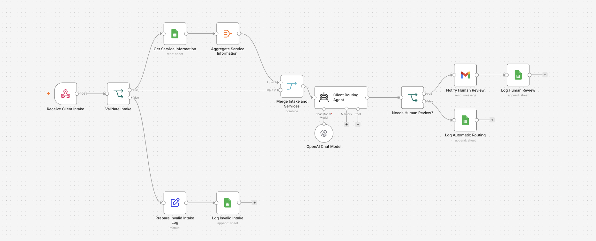

# AI Client Intake and Routing Assistant for a Career Advice Project

## Project Overview

This project automates the initial review and routing of potential clients for a career advice project.

When a potential client submits an intake, the team needs to review information about their professional situation, experience, goals, and main challenges in order to understand what type of support may be most relevant.

The workflow combines information received through a Webhook with service information stored in Google Sheets. An AI Agent analyzes both sources and decides whether it can recommend a next step or whether the case requires human review.

The objective is not to fully automate client decisions, but to reduce repetitive manual work while keeping human intervention for ambiguous or out-of-scope cases.

## Business Case

The process being automated is the first review and classification of potential client intakes.

Each intake includes information such as:

- current professional situation;
- role or area of interest;
- years of experience;
- professional goal;
- main challenge or support needed.

The automated workflow:

1. Receives the client intake through a Webhook.
2. Validates that the minimum required information is available.
3. Reads service information from Google Sheets.
4. Combines the client data with the available service information.
5. Uses an AI Agent to analyze the case.
6. Decides whether the case can be routed automatically or requires human review.
7. Records the result and notifies the team when human intervention is needed.

## ROI Estimate

Reviewing one intake manually takes approximately 10–15 minutes.

With an estimated 20 intakes per week, the current manual workload is:

- 200–300 minutes per week;
- approximately 3 hours 20 minutes to 5 hours per week;
- approximately 13–20 hours per month.

If the workflow automates the first review for around 80% of cases, while leaving ambiguous cases for human review, the estimated time saved would be approximately:

- 2.7–4 hours per week;
- 11–16 hours per month.

The main benefit is not only time saved, but also scalability. As intake volume increases, the automated first review can process additional cases without increasing manual effort at the same rate.

The automation would stop making sense if intake volume were extremely low, implementation and maintenance costs became higher than the time saved, or the majority of cases required human judgment.

## Workflow

`Webhook → Input Validation → Google Sheets → AI Agent → Routing Decision → Google Sheets / Gmail`

The workflow uses two different input sources:

- **Webhook:** receives the potential client's intake data.
- **Google Sheets:** provides reference information about the available career advice services.

The AI Agent analyzes both sources and decides whether the case can be routed automatically or requires human review.

## Why an AI Agent?

An AI Agent is used because this step requires more than generating text.

The agent needs to evaluate the client's context together with the available service information and make a routing decision between different possible outcomes.

A simple LLM chain would be appropriate for a fixed transformation or text-generation task, but in this workflow the model needs to apply decision rules, handle ambiguity, and determine when human intervention is required.

## Model Choice: Cloud vs. Local

The main AI Agent uses a cloud-based model.

The decision is based on three factors:

- **Cost:** expected message volume is initially low to moderate, so usage-based pricing is more practical than maintaining dedicated local infrastructure.
- **Privacy:** the workflow mainly processes professional context and career-related information. The amount of data sent to the model can also be limited to what is necessary for routing.
- **Maintenance and availability:** a cloud model avoids the need to maintain hardware, deploy model updates, or manage local infrastructure.

The main limitation is dependency on an external provider and increasing usage costs if volume grows significantly.

If usage increased substantially, a hybrid or local model could be considered for simpler classifications.

## System Prompt

```text
You are an internal assistant for a career advice project.

Your role is to perform an initial review of potential client intakes and help determine which available service may be the most relevant next step.

Use only the information provided in the client intake and the service information available to you.

Rules:
- Do not invent information about the client.
- Do not invent services, prices, availability, or guarantees.
- Do not promise employment outcomes.
- If information is insufficient or ambiguous, do not make a confident recommendation.
- If the case is outside the scope of the available services, route it to human review.
- If the user explicitly asks to speak with a person, do not attempt to resolve the request automatically.

Human escalation:
When a case requires human review, begin the response exactly with:

[HUMAN_REVIEW]

Do not use this tag when human review is not required.

Keep responses concise, clear, and appropriate for an internal routing workflow.
```

## Error Handling and Edge Cases

The workflow includes control points to reduce the risk of incorrect automated actions.

### 1. Missing or incomplete intake data

An IF validation step checks whether the minimum required client information is available before the AI Agent processes the case.

If key information is missing, the workflow routes the case to human review instead of generating an automatic recommendation.

### 2. Ambiguous or out-of-scope cases

The System Prompt instructs the AI Agent to use the `[HUMAN_REVIEW]` tag when the case cannot be handled safely or confidently.

An IF node checks the agent output for this tag and sends those cases through the human-review path.

### 3. Integration failures

External services such as Google Sheets or Gmail may fail because of connection, permission, or authentication issues.

These points can be monitored using n8n error-handling logic so failed executions do not continue with incomplete data.

## Outputs

The workflow produces two possible outcomes:

- **Automatic routing:** the result is recorded in Google Sheets.
- **Human review:** the case is flagged and the team is notified by email.

This keeps the automated process useful while preserving human control over ambiguous or higher-risk decisions.

## Testing

The workflow is tested with at least three scenarios:

1. A complete intake that can be routed automatically.
2. A case that explicitly requires human review.
3. An intake with missing or invalid data.

The screenshots below show the workflow canvas and successful test executions.

## Screenshots

### Workflow Overview



### Successful Automatic Routing


### Human Review Path


### Error Handling


## Repository Contents

```text
.
├── README.md
├── workflow-ai-client-routing.json
└── screenshots/
    ├── workflow-overview.png
    ├── successful-run.png
    ├── human-review.png
    └── error-handling.png
```

## Security Note

No credentials or API keys are included in the exported workflow.
